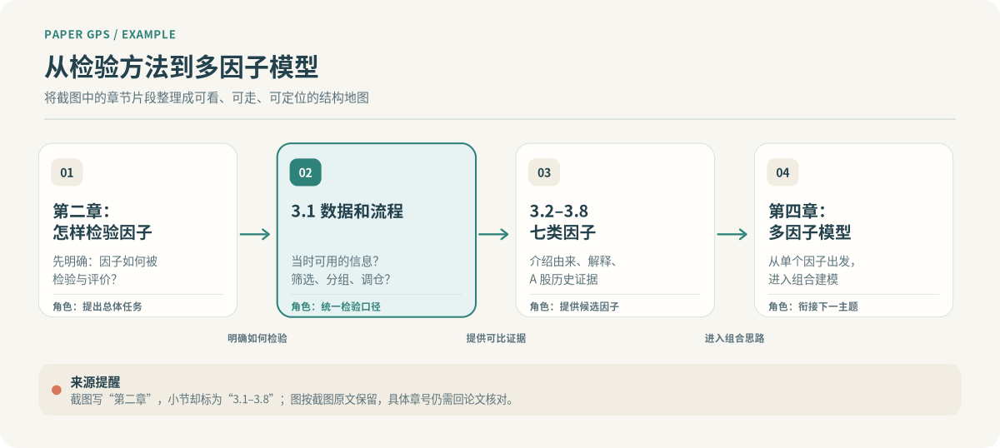
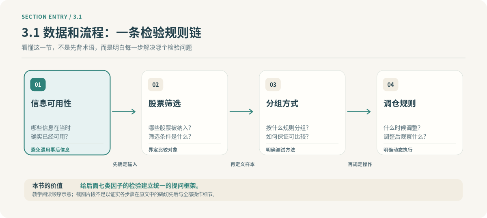
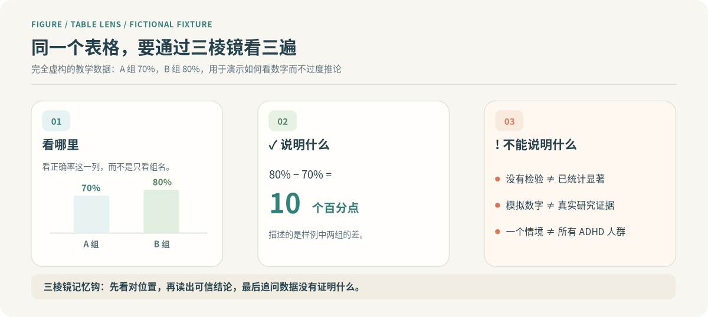

# 视觉优先 Skill：实际输出应该是什么样？

> **可视化成品示范，并非某个 AI 模型已通过端到端运行的报告。**
> 第一、二张图根据用户截图中的章节文字制作；仅有这些信息时，不应假装读过整篇原始论文。
> 第三张图引用 `evals/fixture-paper.md` 的**完全虚构**数字演示图表三棱镜。
>
> 如果你的聊天环境只出现「纯文本」大框、下箭头和列表，而看不到真正渲染的图，就说明输出没有达到这个 Skill 的视觉合同。

## ① 第一次看：宏观 Paper GPS

**主线问题**：先知道“怎么检验一个因子”，再读“哪些因子有证据”，最后理解“为什么要把单因子组合”。

**一眼带走**：3.1 的职责是建立统一检验口径；3.2–3.8 提供候选因子；第四章进入组合层面的讨论。

**来源提醒**：用户截图写的是“第二章”，下面却出现 `3.1` 和 `3.2–3.8`。这里**保留原始写法并提示待核对**，不擅自把第二章改成第三章。仅可确定截图这些文字，不能编造七类因子的具体名字、历史收益或因子测试结果。

[查看可缩放 SVG 原图](../assets/diagrams/factor-paper-map.svg)

---

## ② 进入 3.1：详细小节流程图

**前置三问**

1. **核心回答什么？** 哪些信息当时可用？股票如何筛选、分组、调仓？
2. **在全篇起什么作用？** 为后续检验不同因子提供可比较的方法规则。
3. **承接上一节什么？** 从“要检验因子”的总体任务，落到真正能够执行的检验步骤。

**图下解释**：你可以先用“可用信息—筛选—分组—调仓”作为阅读导航，每看完一步都问自己：**这一项规定，会怎样影响后面看到的因子比较结果？**

**不能说明什么**：截图片段没有完整方法细节，所示先后顺序属于**教学组织方式**，不能冒充作者的原文流程顺序。

[查看可缩放 SVG 原图](../assets/diagrams/section-method-flow.svg)

---

## ③ 看图表：三棱镜到底长什么样？

此处切换成一个独立的**教学模拟**：表中 A 组正确率 70%，B 组 80%，两组各回答 200 题。这与前面的因子论文截图**不是同一个研究**。

- **看哪里**：Table 1 中 Accuracy 列，注意两组分母。
- **说明什么**：模拟数据中 B 组比 A 组高 **10 个百分点**。
- **不能说明什么**：未报告显著性检验，不能宣称“显著提高”；教学模拟更不能外推到所有 ADHD 学习者。

[查看可缩放 SVG 原图](../assets/diagrams/evidence-prism.svg)

---

## ④ 单轮理解，不强迫答题

**本轮只需要带走一句话**：

> 一篇论文的**检验口径**影响后续因子证据的可比性，而**证据又决定后续组合模型能推到什么程度**。

你可以说“下一节”“展开 3.1 的信息可用性”“给我算一个数值例子”，或者“跳过测试”。

---

## 如何判断别的 AI 是否真的使用了这个 Skill？

**合格**：有已渲染的图、箭头有具体关系、当前节高亮、数据和来源可靠、图下说明推断边界。

**不合格**：给你一个带“纯文本”标签的大代码框、只用 `↓` 连接标题、凭截图编造七类因子名称、把教学模拟当成真实研究。

v5.0 的新论文图示由已经注册的 MCP 工具根据**原文信息**重新生成；本文件里的图片只用来说明视觉质量要求，不代表已完成商业客户端的端到端实测。
