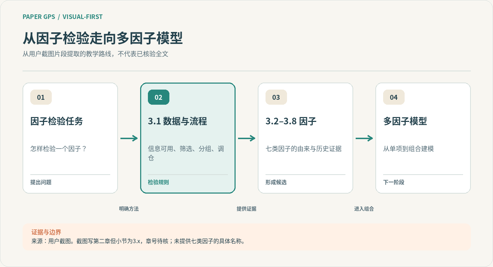
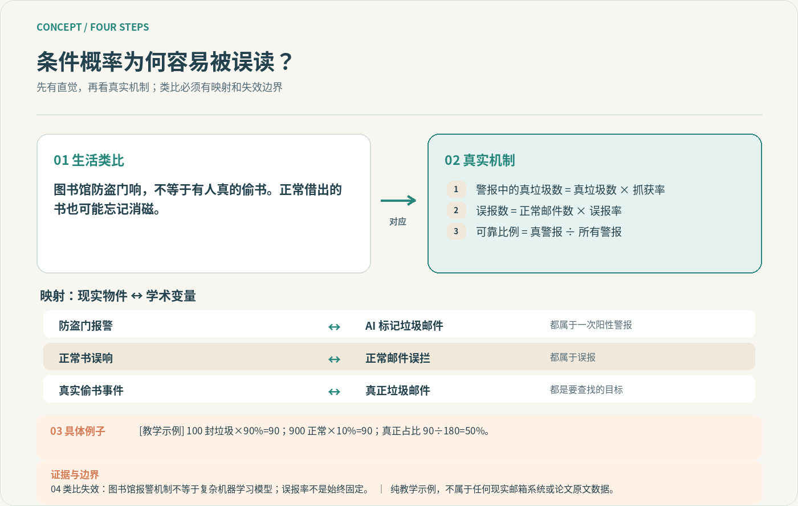
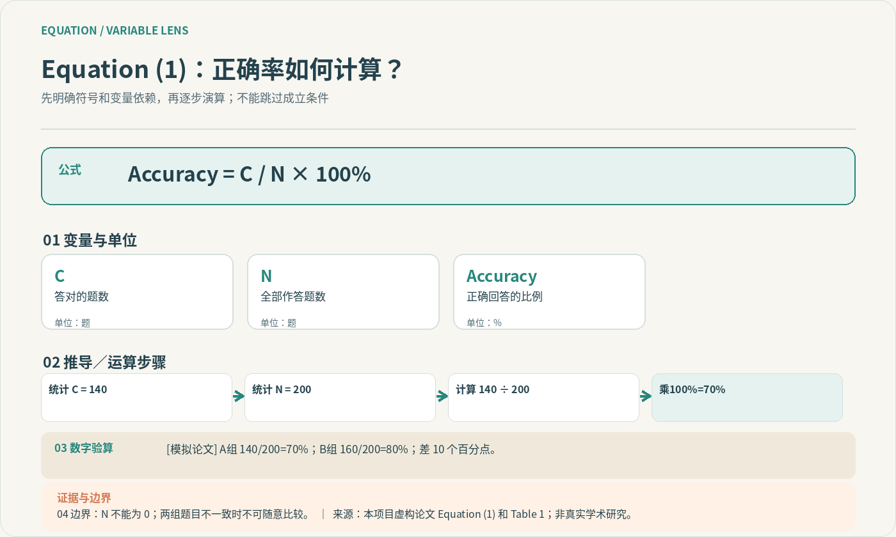
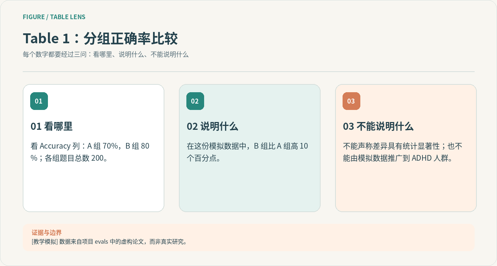

# ADHD Paper Deep Learning v5.0 🧠

**视觉优先的论文陪读 Skill + 真正可调用的 MCP 图形工具。**  
支持 GitHub Copilot、Claude Code、Cursor。中文设计，适合需要清楚逻辑地图、短段落、真实算例、证据边界与分层复习的学习场景。

本项目是**双层架构**，不是只有一份提示词：

- **Agent Skill**：决定*什么时候*画图、如何用生活类比讲概念、怎样解释原文、何时复习。
- **独立 MCP Server**：提供 5 个可由模型自动调用的渲染工具，真正返回 `image/png` 内容，而不是把 Mermaid、SVG 或箭头纯文本丢给读者。

> ✅ 已测试：MCP stdio 初始化、5 工具发现、真实 PNG ImageContent、无效参数拒绝、Linux 字体下的五类图、Python 单元与协议级端到端测试。
>
> ⚠️ 未宣称：本仓库上传到 GitHub 后就自动注册到用户所有 AI 账号、已经经过三种商业客户端的端到端现场授权测试、能自行读懂所有 PDF、或能保证 ADHD 学习者一次就永久记住。

## 先看看真正会生成什么图

### ① 论文宏观结构：先认方向



**读者先知道“现在在哪、上一节做了什么、下一节为什么要出现”。**

### ② 概念解构：生活类比 → 真机制 → 计算 → 边界



### ③ 公式：符号、单位、计算链与极端条件



### ④ 三棱镜：图表能说明什么、不能说明什么



[查看五张示例图](examples/) · [打开交互演示（HTML）](docs/index.html)（GitHub Pages 可从 `/docs` 发布；静态页面不等于已连接 MCP）

---

## 一、最短安装：三步完成本地 Tool 注册

**环境**：Python 3.11+、可以 `pip install`、本机安装有支持中文的字体（Noto Sans CJK、苹方或微软雅黑）。本 MCP Server 无需网络 API Key，**只运行本地 stdio**。

1. 下载仓库解压并用 GitHub Copilot（VS Code）/ Claude Code / Cursor 打开**仓库根目录**。
2. 在该仓库目录的终端执行：

   ```bash
   python -m pip install -e .
   ```

3. 重启 Agent 或刷新 MCP 配置，并在宿主的 MCP 工具列表里查看 `adhd-paper-visuals`。然后输入：

   > 用 `adhd-paper-deep-learning` 帮我分析论文。请先核实论文目录，再调用 `render_paper_map` 给我一张**真正显示的全局流程图**。之后进入重要章节先做三问，概念四步解析，公式和图表使用对应 MCP 工具。不要给我纯文本框冒充流程图。

**如果命令 `python` 找不到**：Linux/macOS 可能需要 `python3`；Windows 可查看 `py -0p`。随后把 `.mcp.json` / `.cursor/mcp.json` 里的 `"command": "python"` 替换成**同一个解释器的绝对路径**，否则 Agent 找不到你安装的包。

**中文显示为方块**：在系统上安装支持中文的字体；也可以设置 `ADHD_PAPER_FONT` 到本机字体路径。**不要向 GitHub 上传字体文件**。如果服务器提示缺少字体，它不会伪装图片已正确生成。

## 二、跨平台配置与安装状态

| 平台 | 可自动发现的项目 Skill | MCP 配置文件 | 是否需要用户操作 |
|---|---|---|---|
| **GitHub Copilot（VS Code / CLI）** | `.github/skills/adhd-paper-deep-learning/` | 根目录 `.mcp.json` | 安装本地包、信任项目、开启工具 |
| **GitHub Copilot cloud agent** | `.github/skills/adhd-paper-deep-learning/` | 手动粘贴 `configs/copilot-cloud-mcp.json` 到仓库设置 | **需要管理员设置**，并使 setup steps 位于默认分支 |
| **Claude Code** | `.claude/skills/adhd-paper-deep-learning/` | 根目录 `.mcp.json` | 安装包、接受项目 MCP 信任 |
| **Cursor** | `.cursor/skills/adhd-paper-deep-learning/` | `.cursor/mcp.json` | 安装包、在 Tools 中启用 |
| **旧式 VS Code MCP** | `.github/skills/...` | 可选 `configs/vscode-mcp.example.json` | 用于不读取根目录 `.mcp.json` 的旧版宿主，不与之重复启用 |

### GitHub Copilot（本地 VS Code / CLI）

- 打开仓库，确认 `.github/skills/adhd-paper-deep-learning/SKILL.md` 存在。
- 确认 `.mcp.json` 已被信任；Copilot CLI 可以在工作区 MCP 配置被加载时使用。VS Code 当前支持根目录 `.mcp.json`（旧版本可能只支持 `.vscode/mcp.json`）。
- 运行 `python -m pip install -e .` 并在 VS Code 命令面板运行 **MCP: List Servers**；应显示 `adhd-paper-visuals`。
- 在 Chat 中明确提到 Skill 或选择相关论文工作；是否自动选中由模型和产品设置决定。

官方：[GitHub Agent Skills](https://docs.github.com/en/copilot/how-tos/copilot-on-github/customize-copilot/customize-cloud-agent/add-skills) · [VS Code MCP 配置](https://code.visualstudio.com/docs/agent-customization/mcp-servers)

### GitHub Copilot Cloud Agent（额外设置）

**仓库中有 Skill ≠ 云端 MCP 已注册。** 请用具备权限的仓库账号：

1. 将整个项目上传到 GitHub，确保 `.github/workflows/copilot-setup-steps.yml` 在**默认分支**。
2. 打开仓库 **Settings → Copilot → MCP servers**。
3. 将 [`configs/copilot-cloud-mcp.json`](configs/copilot-cloud-mcp.json) 的完整 JSON 复制到该页面，保存。
4. 该配置明确 allowlist 五个只读绘图工具。云端使用 setup steps 安装 Python 包与中文字体；配置仍可能受组织授权、网络、运行器及策略限制。
5. 在 cloud agent 任务中请求“用 `adhd-paper-deep-learning` 并调用 `adhd-paper-visuals` 绘制论文总览”，检查工具调用日志和图片返回情况。

注意：GitHub 的 cloud agent / code review 对 MCP 使用有独立权限机制；这里是**已准备好可复制的配置**，并不是在你的 GitHub 账号中自动操作完成的注册。

官方：[配置仓库 MCP](https://docs.github.com/en/copilot/how-tos/copilot-on-github/customize-copilot/configure-mcp-servers) · [Copilot 环境预安装](https://docs.github.com/en/copilot/how-tos/copilot-on-github/customize-copilot/customize-cloud-agent/customize-the-agent-environment)

### Claude Code

- 项目 Skill 路径为 `.claude/skills/adhd-paper-deep-learning/SKILL.md`；MCP 路径为仓库根目录 `.mcp.json`。
- 启动 `claude`，确认项目目录受信任，并批准 `.mcp.json` 中的 MCP 服务器。
- 终端执行 `claude mcp list`，或在 Claude Code 输入 `/mcp` 核验连接。
- 可以明确输入 `/adhd-paper-deep-learning`，或给出与 Skill 匹配的任务请求。

官方：[Claude Code Skills](https://code.claude.com/docs/en/skills) · [Claude Code MCP](https://code.claude.com/docs/en/mcp)

### Cursor

- 项目 Skill：`.cursor/skills/adhd-paper-deep-learning/SKILL.md`。
- 工具注册：`.cursor/mcp.json`，包含本地 `python -m adhd_paper_mcp`。
- 安装依赖后，在 Cursor **Settings → MCP / Tools** 检查 `adhd-paper-visuals`。Cursor CLI 可用 `cursor-agent mcp list` 及 `cursor-agent mcp list-tools adhd-paper-visuals`。
- 请求论文地图时工具应返回 **PNG 图片内容**，否则先查看 MCP 运行日志。

官方：[Cursor Skills](https://cursor.com/help/customization/skills) · [Cursor MCP](https://docs.cursor.com/context/model-context-protocol)

---

## 三、服务确实注册了哪些独立工具？

| MCP 工具名 | 输入要提供什么 | 返回 |
|---|---|---|
| `render_paper_map` | 核实过的章节、职责、关系、当前所在节与来源说明 | 真实 PNG 论文全局图 |
| `render_section_flow` | 本节真实步骤、对应问题与前后关系 | 真实 PNG 章节流程图 |
| `render_concept_diagram` | 生活类比、映射、机制、数字例子、失效边界 | 真实 PNG 概念图 |
| `render_formula_structure` | 原式、变量与单位、逐步计算、例子、限制 | 真实 PNG 公式结构图 |
| `render_evidence_prism` | 看哪里、能说明什么、不能说明什么及来源 | 真实 PNG 证据三棱镜 |

五个工具都标记为 **MCP read-only**：它们不写文件、不查询网络、不调用系统命令、不读取你的论文文档。调用者提供文字，服务校验输入并绘制图像。为了避免被错误资料欺骗，**Skill 层必须先读原文并确保输入准确**。有疑点必须明确写在 `source_note`，不能补造图中未知数字。

图片返回基于 MCP `tools/call → content: [TextContent, ImageContent]`。如果客户端不显示 ImageContent，协议层返回图片不代表所有 UI 都会自动渲染；可参见测试或另行导出 PNG。

## 四、实际的完整项目结构

```text
adhd-paper-deep-learning/
├── README.md                         # GitHub 首页
├── pyproject.toml                    # pip 安装的独立工具服务
├── .mcp.json                         # Claude Code / Copilot 工作区 MCP
├── .github/
│   ├── skills/adhd-paper-deep-learning/    # Copilot 项目 Skill
│   └── workflows/                         # CI + Cloud agent setup
├── .claude/skills/adhd-paper-deep-learning/ # Claude 项目 Skill
├── .cursor/
│   ├── skills/adhd-paper-deep-learning/    # Cursor 项目 Skill
│   └── mcp.json                            # Cursor MCP
├── skill/                            # 唯一需要人工维护的源 Skill
│   ├── SKILL.md
│   ├── references/                    # 学术解构、ADHD 设计、视觉规范
│   ├── assets/                        # 模板和静态 SVG/PNG 示例
│   └── examples/
├── src/adhd_paper_mcp/              # 真正运行的 stdio MCP Server
│   ├── server.py                     # initialize / tools/list / tools/call
│   ├── graphics.py                   # 绘制 PNG
│   └── __main__.py
├── configs/                          # Copilot 云端 / VS Code 配置参考
├── examples/                         # 5 张真实工具输出 PNG + 输入 JSON
├── docs/                             # 可选独立静态展示网页
├── tests/test_mcp.py                 # MCP 协议与图片测试
└── scripts/                           # 演示及三平台 Skill 镜像同步
```

## 五、测试：你可以自己验证是否“真能调用”

在仓库根目录执行：

```bash
python -m pip install -e .
python scripts/sync_platform_skills.py --check
python scripts/validate_repo.py
python -m unittest discover -s tests -v
python scripts/demo.py
```

其中 `test_mcp_wire_returns_real_image` 会：

1. 真实启动 `python -m adhd_paper_mcp` 子进程；
2. 发送 MCP `initialize`；
3. 发送 `tools/list`；
4. 发送 `tools/call`；
5. 从标准 `ImageContent` 中解码 PNG 并检查图像。

运行结果应包括 `Ran ... tests ... OK`。如果某一步失败，不应继续声称平台已经完成安装。

**测试环境说明**：项目在开发环境的中文字体上完成图像验证，GitHub Actions 也会安装 Noto CJK 再测试；我们没有代表你在 GitHub.com、Claude 或 Cursor 内执行需要你的账号授权的最终上线操作。

## 六、把 ZIP 上传 GitHub（重要）

1. 下载 ZIP，**解压**。
2. 创建新仓库 `adhd-paper-deep-learning`。
3. 把压缩包中 `adhd-paper-deep-learning/` **内部所有文件**上传至仓库根目录（含 `.github`、`.claude`、`.cursor` 等隐藏目录）。
4. 提交后，GitHub Actions 会执行测试。若测试通过，再按你要用的平台完成 MCP 信任/仓库设置。

推荐命令行上传，能避免漏传隐藏目录：

```bash
git init
git add -A
git commit -m "Add ADHD paper visual Skill and MCP v5"
git branch -M main
git remote add origin https://github.com/<your-user>/<your-repo>.git
git push -u origin main
```

这只是需要你在**自己电脑上操作**的示例；不能把整段原样执行前，先替换 `<your-user>` / `<your-repo>`，并确认仓库地址与已有 Git 状态。

## 七、设计边界与安全

- **不是治疗方案**：针对 ADHD 的阅读分块、回忆与低负荷视觉设计可由读者选择，不假定存在统一的认知风格。
- **不会伪造事实**：最重要的内容边界来自论文原文，不来自漂亮的图。
- **不会神奇地自动发现所有图**：需要宿主/模型能读取论文 PDF 并调用 MCP；MCP 绘图服务不负责 PDF 解析。
- **只实现 MCP stdio 的工具子集**：本项目是轻量独立实现，支持常用 MCP 客户端需要的 initialize、ping、tools/list、tools/call 和通知处理；不提供 HTTP、OAuth、resources、prompts 或远程托管。希望加入远端部署可在此基础上迁移到官方 MCP SDK。
- **隐私**：MCP 工具无网络请求、无写入图像到磁盘的副作用；示范脚本 `scripts/demo.py` 会把图片保存进本地 `examples/`，这是用户显式执行时的行为。
- **开源许可**：此包未主动为你选择 LICENSE；如果准备向公众授权复制和再分发，可以自行添加 MIT / Apache-2.0 或其他适当许可。

---

**版本 v5.0。** 项目内所有示范研究与样本数值均显式区分真实论文和教学模拟；演示图片本身不构成科学证据。
